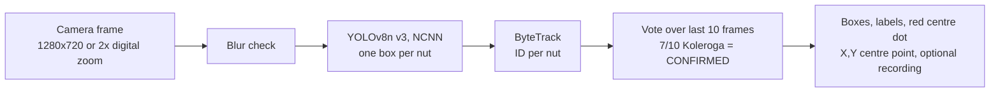

# Arecanut_Detection: Koleroga detection on a Raspberry Pi 5

A camera-based vision system that detects arecanut (areca nut) and classifies nuts as
**Healthy** or affected by **Koleroga** (fruit rot), giving the centre point of each diseased nut.
Runs live on a Raspberry Pi 5. Work in progress.

- **Model:** YOLOv8n (Ultralytics), 2 classes: `Healthy_nut`, `Koleroga_detector`
- **On board:** Raspberry Pi 5 + Raspberry Pi Camera Module 3, model exported to NCNN

## How it works



Each nut keeps an ID across frames and its label is a vote over recent sharp frames, so labels
do not flicker, and a Koleroga nut is only confirmed after 7 of 10 frames agree.

## Results so far

| | v2 | v3 (current) |
|---|---|---|
| Training data | 2,360 images, 0 background | 2,465 images + 544 background (no-nut) images |
| Koleroga recall (validation) | 0.759 | **0.785** |
| Koleroga precision | 0.845 | 0.827 |
| Koleroga mAP50 | 0.855 | 0.857 |
| Healthy_nut mAP50 | 0.955 | 0.953 |
| False alarms on non-nut validation images (conf 0.35) | faces/hands detected on the Pi | **0 / 108** |

Training: 100 epochs, 640 px, Google Colab T4.

**Honest limits:** tested on single nuts and screens, not yet on real bunches in a plantation;
Koleroga training photos are mostly hand-held close-ups; lookalike objects (eggs, almonds) can
trigger detections; Camera Module 3's autofocus lens blurs under vibration (see `sharp_capture.py`).

## Repository

| Folder / file | What it does |
|---|---|
| `dataset_tools/prepare_for_roboflow.py` | Removes exact duplicate images, fixes auto-generated YOLO labels (drops the confidence column, clamps boxes), writes `data.yaml` and a review-priority list |
| `training/colab_train_v2.py` | Colab cells: download Roboflow dataset, train, evaluate per class, export NCNN |
| `training/colab_train_v3.py` | Same, plus adding background (no-nut) images with empty labels |
| `pi/pi_detect_v2.py` | **Main live detector**: one box per nut, tracking + voting, CONFIRMED targets, digital zoom, fixed focus, fast shutter, blur filter, recording, headless mode |
| `pi/pi_live_detect.py`, `pi/pi_detect_record.py` | First simple versions (no tracking) |
| `pi/capture_on_detect.py` | Field data collection: saves full 12 MP photos only when a nut is detected (+ optional interval photos) |
| `pi/sharp_capture.py` | Takes a burst of 12 MP frames and keeps the sharpest; reduces vibration blur |
| `pi/collect_negatives.py` | Saves frames where the model wrongly detects something, as background training images |
| `tools/vibration_blur_test.py` | Measures image sharpness (motors off vs on, mount A vs B) |
| `tools/pixhawk_link_test.py` | Pi to Pixhawk USB test: heartbeat, mode, attitude, GPS, battery |

## Quick start (Raspberry Pi 5)

```bash
sudo apt install -y python3-picamera2
python3 -m venv --system-site-packages ~/yoloenv
~/yoloenv/bin/pip install -r requirements-pi.txt
# put the exported model folder best_ncnn_model/ next to the scripts, then:
cd pi
~/yoloenv/bin/python pi_detect_v2.py                       # live view, zoom 1, autofocus
~/yoloenv/bin/python pi_detect_v2.py --zoom 2 --focus-m 1.0 # more range, fixed focus
~/yoloenv/bin/python pi_detect_v2.py --record --no-display  # no monitor, records to disk
```

Plain photos without detection (camera mounted upside down):

```bash
rpicam-still -t 0 --keypress --rotation 180 --datetime --autofocus-mode manual --lens-position 0.7 --shutter 1000 --gain 4
```

## Model weights

Weights are not stored in the repo. Download `best_v3.pt` / `best_ncnn_model.zip` from the
[Releases](../../releases) page.

## Roadmap

- Range test with real nuts at 0.5 to 3 m
- Vibration fixes for the camera; fixed-focus camera if needed
- Real-field dataset (bunches on trees, bark and fronds as background) for model v4

## Credits and license

Initial images came from public Kaggle/Roboflow datasets and papers; check each source's license
before reusing the data. Built with [Ultralytics YOLO](https://github.com/ultralytics/ultralytics)
(AGPL-3.0), so this repository is released under **AGPL-3.0** (see `LICENSE`).
